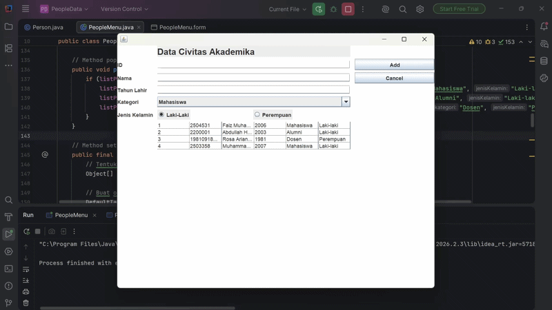
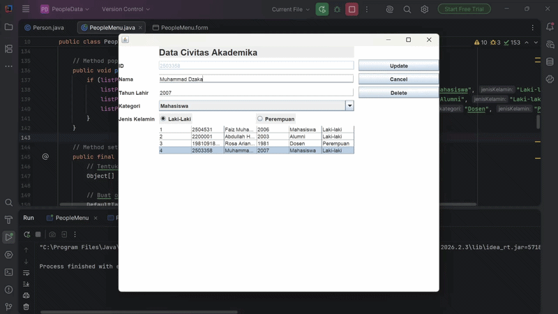
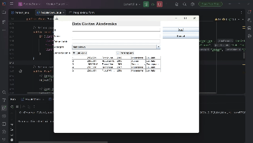

# TP4 DPBO

# Sumpah Pemuda
Saya <strong>Faiz Muhammad Ghazali</strong> dengan <strong>NIM 2504531</strong> mengerjakan Tugas Praktikum 4 dalam mata kuliah Desain dan Pemrograman Berorientasi Objek untuk keberkahanNya maka saya tidak melakukan kecurangan seperti yang telah dispesifikasikan. Aamiin.

# Desain
- Person
  - id : String
  - nama : String
  - tahunLahir : int
  - kategori : String
  - jenisKelamin : String
- PeopleMenu
  - JTextField idField;
  - JTextField namaField;
  - JTextField tahunLahirField;
  - JComboBox<String> kategoriComboBox;
  - JRadioButton rbLaki;
  - JRadioButton rbPerempuan;
  - ButtonGroup bgGender;
  - JTable personTable;
  - JButton addUpdateButton;
  - JButton deleteButton;
  - JButton cancelButton;
  - JLabel titleLabel;
  - JPanel mainPanel;

# Struktur File
```
Main
├── PeopleData/
│   └── src/
│       ├── Person.java
│       ├── PeopleMenu.java
│       └── PeopleMenu.form
│
├── Dokumentasi/
│   └── Remove.gif
│   └── Add.gif
│
└── README.md
```

# Penjelasan Program

Program ini menerapkan konsep Pemrograman Berorientasi Objek (**OOP**) dan pengembangan antarmuka grafis menggunakan **Java Swing** dalam studi kasus **Aplikasi Pendataan Civitas Akademika (PeopleData)**.

Sistem memiliki beberapa komponen kelas yang saling terhubung:
1. **Person**: *Model class* yang menyimpan atribut dasar individu seperti ID, nama, tahun lahir, kategori, dan jenis kelamin.
2. **PeopleMenu**: *Controller & GUI class* berbasis JFrame yang menangani antarmuka formulir, tabel data, serta logika CRUD (*Create, Read, Update, Delete*).

**Fitur & Ketentuan Utama:**
- Inisialisasi data awal sivitas akademika ke dalam *ArrayList*.
- Penambahan data person baru melalui form input interaktif (`idField`, `namaField`, `tahunLahirField`, `kategoriComboBox`, dan `rbLaki`/`rbPerempuan`).
- Pembaruan (*update*) data person yang sudah ada dengan memilih baris pada tabel.
- Penghapusan data dengan konfirmasi prompt dialog (*confirmation dialog*).
- Pembersihan form secara otomatis menggunakan fungsi `clearForm()`.

## ❌ ERROR HANDLING & VALIDASI

Program dilengkapi dengan penanganan kesalahan untuk memastikan integritas data input:
- **Validasi Kosong:** Program memeriksa apakah field ID atau Nama kosong sebelum data dimasukkan atau diubah.
- **Validasi Angka (*NumberFormatException*):** Program memastikan bahwa input pada field tahun lahir harus berupa angka yang valid menggunakan blok `try-catch`. Jika salah, pesan *error* akan muncul melalui `JOptionPane`.

# Dokumentasi

## Add


## Update


## Remove

